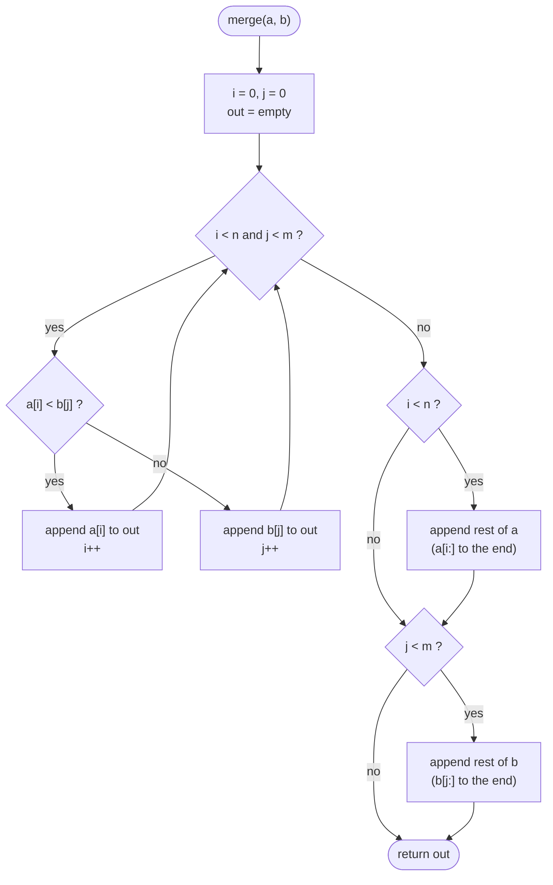

# Merging (Approach 1)
-two pointer merging. Commonly used in mergesort.
## key actions
- Hold a pointer for each arrays.
- create a joint array(out) to return as the sort.
- loop until any pointer runs out. append smallest value and push the index of the smallest value to next.
- loop separately to scrape the remainders.

### Code
<table>
<th>Java</th><th>Python</th>
<tr><td>
    
```java
public static int[] merge(int[] a, int[] b){
    int i=0, j=0, idx=0, n=a.length, m=b.length;
    int[] out = new int[n+m];
    while(i<n && j<m){ //joint loop
        if(a[i]<b[j]) out[idx++]=a[i++];
        else out[idx++]=b[j++];
    }
    while(i<n) out[idx++]=a[i++]; //fetching the remainders
    while(j<m) out[idx++]=b[j++];
    return out;
}
```

</td><td>
    
```python
def merge(a, b):
    i = j = 0
    out=[]
    while i<len(a) and j<len(b):
        if a[i]<b[j]:
            out.append(a[i])
            i+=1
        else:
            out.append(b[j])
            j+=1
    out.extend(a[i:])
    out.extend(b[j:])
    return out
```

</td></tr>
</table>

### Flow



# Mergesort Algorithm

## key actions
- **Base case:** len(arr)<=1, no need to sort, just return the array!
- Split the arrays midway
- Send both into the recursion.
- Merge and Return.

### Code
<table>
<th>Java</th><th>Python</th>
<tr><td>
    
```java
public static int[] mergesort(int[] arr){
    int len = arr.length;
    if(len<=1) return arr; // base case
    int mid = len/2;
    int[] x = Arrays.copyOfRange(arr, 0, mid);
    //221 allows certain functions.
    int[] y = Arrays.copyOfRange(arr, mid, len);
    return merge(mergesort(x),mergesort(y));
    // merge is custom function.
}
```

</td><td>
    
```python
def mergesort(arr):
    l = len(arr)
    if(l<=1): return arr #base case
    mid = l//2
    x = mergesort(arr[0:mid])
    y = mergesort(arr[mid:l])
    return merge(x,y) #merge is custom function.
```

</td><tr>
</table>
